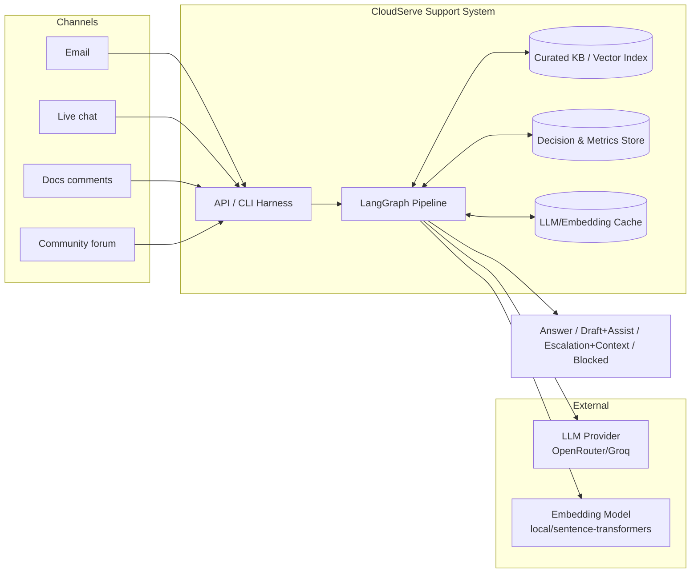

# HLD — CloudServe Intelligent Support System (T10)

**Version:** 0.1 (draft)  
**Date:** 2026-11-22  
**Inputs:** [PRD v1](../prd/PRD_v1.md), [traceability](../prd/traceability.csv), [decision log schema draft](../governance/decision_log_schema_draft.md), [never_do](../governance/never_do.md), Stage 1 artifacts (EV-01–EV-39)  
**Related:** [LLD.md](LLD.md), [component_req_map.md](component_req_map.md), ADRs in `../decisions/`

## 1. Goals and architectural intent
Design an **evidence-grounded support decision-and-assistance system** (not a generic chatbot) that:
- Normalizes multi-channel tickets, classifies intent/urgency with confidence, retrieves grounded KB evidence, and routes deterministically to **auto-answer**, **assist/draft**, or **escalate**.
- Generates cited, structured responses only when evidence/policy allow; validates every response pre-release with blocking guardrails.
- Logs auditable decisions and degrades gracefully under provider/input/retrieval failures (A11).
- Runs unattended over an input dataset path and produces code-calculated metrics/reports (A9/A10/A12).

**Key findings informing design:** 71.4% dev tickets answerable-from-docs but outcomes lag (EV-29–EV-31); no-doc/restricted intents must escalate/abstain (EV-37–EV-38); escalation context and explainability required (EV-15–EV-16); curated KB grounding/citations required (EV-19–EV-21, EV-35–EV-36).

## 2. System context and boundaries


**In scope:** ingest, classify, retrieve, route, generate, validate, decision logging, metrics/reporting, harness/test execution, provider abstraction/resilience.  
**Out of scope (v1):** autonomous handling of no-doc/sensitive intents, learning from unreviewed snippets, paid-capacity dependence, production CRM integrations, validation/hidden-set tuning.

## 3. Logical architecture (6 components, 3 concerns)

| Layer | Components | Responsibilities | Primary REQs |
|---|---|---|---|
| Intake & understanding | **Ingest**, **Classify** | Normalize multi-channel tickets; assign intent/urgency/confidence/alternatives with safe fallback | REQ-F-ING-001/002, REQ-F-CLS-001/002 |
| Evidence & decision | **Retrieve**, **Route** | Retrieve ranked, thresholded KB passages with resolvable IDs; deterministic policy routing and escalation packaging | REQ-F-RET-001/002, REQ-F-RTE-001/002 |
| Response & control | **Generate**, **Validate** | Produce grounded, cited, structured responses or abstain; pre-release blocking checks and recorded outcomes | REQ-F-GEN-001/002, REQ-F-VAL-001/002 |
| Cross-cutting | **Logging/Audit**, **Monitoring/Metrics**, **Governance/Safety** | Append-only decision records, operational/governance metrics, policy enforcement (no-doc/must-not-auto/PII/fairness) | REQ-X-LOG-001, REQ-X-MON-001, REQ-X-GOV-001, REQ-NF-* |

## 4. Orchestration and data flow (LangGraph)

```mermaid
flowchart TD
  S([Start ticket]) --> I[Ingest/Normalize]
  I --> C[Classify intent+urgency+confidence]
  C --> R[Retrieve KB passages]
  R --> RT{Route (pure function)}
  RT -->|auto_answer| G[Generate grounded answer]
  RT -->|assist_draft| G
  RT -->|escalate/abstain| E[Build escalation package]
  G --> V[Validate pre-release]
  V -->|pass| A[Release answer/draft]
  V -->|block| B[Block + escalate/fallback]
  E --> L[Log decision + emit outcome]
  A --> L
  B --> L
  L --> X([End: answer|draft|escalation|blocked])
```

**State model:** a typed LangGraph state carries raw ticket, normalized ticket, classification, retrieval results, route decision, draft/answer, validation result, timings, errors/fallback flags, and decision-log payload (see LLD).  
**Node behavior:** each node returns typed outputs and never raises unhandled exceptions to terminate the batch; failures produce fallback states routed per policy (A11).

## 5. Key design decisions (summary)
| Decision | Choice | Rationale / evidence | ADR |
|---|---|---|---|
| System framing | Decision-and-assistance pipeline (auto/assist/escalate) vs chatbot-only | Aligns with delivery gap, safety, and escalation needs | ADR-001 |
| Retrieval/chunking | Small metadata-rich chunks with overlap + whole-doc fallback | Short single-blob docs, citation granularity, traceability | ADR-002 (EV-39) |
| Routing | Deterministic pure function `(classification, retrieval, thresholds, policy flags)` | Reproducibility, explainability, testability (A3/A6) | ADR-003 |
| Guardrails | Pre-release, blocking, always-on validators with recorded outcomes | Zero private-data tolerance and no unsupported claims | ADR-004 (EV-05, EV-38) |
| Provider resilience | OpenRouter-first abstraction + disk cache + backoff/rate limiting + degraded mode | Free-tier variability and A11 compliance | ADR-005 |
| Auditability | Append-only decision log with A8 fields and run/ticket correlation | Compliance/explainability and metric reconciliation | ADR-006 |

All departures/adaptations from the brief’s baseline architecture are documented in ADRs with reasons and evidence.

## 6. Data stores and artifacts
| Store/artifact | Purpose | Notes |
|---|---|---|
| Curated KB (`data/documentation.json`) | Grounding corpus | 29 docs, metadata preserved (EV-35, EV-36) |
| Vector index / embeddings store (`storage/`) | Retrieval | Chunk docs + metadata; rebuildable from corpus/config |
| LLM/embedding cache (`storage/cache/` or configured path) | Cost/rate-limit control, reproducibility | Keyed by model/prompt/version/params/input hash |
| Decision/event log (SQLite/structured store) | A8 audit trail and governance metrics | Schema aligned to `decision_log_schema_draft.md` |
| Metrics/report outputs (`evaluation/results/`) | Harness reporting (A9/A10) | Code-calculated JSON/CSV/MD as specified |

## 7. Interfaces and integration
- **CLI/Harness:** `python -m evaluation.harness --input <path> --output <dir>` (A9); batch/unattended.
- **API (FastAPI):** ticket submission and health/status endpoints (design target); reuses same pipeline/services.
- **Provider interface:** adapter for OpenRouter (default) and Groq/alternatives via config; common request/response/error contract.
- **Retrieval interface:** index/search abstraction allowing vector store swap (e.g. Chroma) without pipeline rewrite.

## 8. Failure handling and resilience (A11 summary)
| Condition | Expected behavior |
|---|---|
| No retrieval hit / below threshold | Return insufficient-evidence result; route to escalate/assist per policy; no fabricated answer |
| Provider timeout / 5xx / outage / fully down | Retry with bounded backoff where safe; fallback/degraded typed result; continue batch; log failure |
| Rate limiting (429) | Backoff with jitter, rate limiter, cache reuse; degrade if exhausted |
| Malformed/empty input | Normalize/fail-soft with structured validation outcome; no crash; log and continue |
| Guardrail block | Prevent release, record checks/findings, emit escalation/blocked outcome |

Detailed per-component matrix in [LLD.md](LLD.md).

## 9. Security, privacy, and governance
- Enforce `never_do` policies (no PII/secret leakage, no unsupported claims, no prompt-injection compliance, no auto-answer on insufficient evidence/sensitive no-doc cases).
- Validate every generated response pre-release (blocking). Redact/minimize sensitive data in logs; never commit `.env` or secrets.
- Segment-aware reporting for fairness (language fluency/tier/region) and auditable, manager-readable rationales.

## 10. Observability and quality
- **Logging:** structured events and append-only decision records per ticket.
- **Monitoring:** volume, latency (median/p95), fallback/error rates, provider/rate-limit events, guardrail activations, escalation/block counts.
- **Evaluation hooks:** harness metrics (business/technical/governance), regression baseline support, calibration/fairness analysis inputs.

## 11. Component-to-requirement traceability
See [component_req_map.md](component_req_map.md) for full mapping. Every component has REQ refs, and PRD coverage includes A1–A12 and cross-cutting concerns.

## 12. Risks and open design items
- Threshold/calibration values to be derived from development data and documented (A6, T11/T24/T25).
- Chunk size/overlap and retrieval params to be validated experimentally (ADR-002).
- Final DDL/index choices may be refined during implementation but must preserve A8 fields and traceability.
- Provider/model availability on free tier may affect latency; cache/degraded modes mitigate.